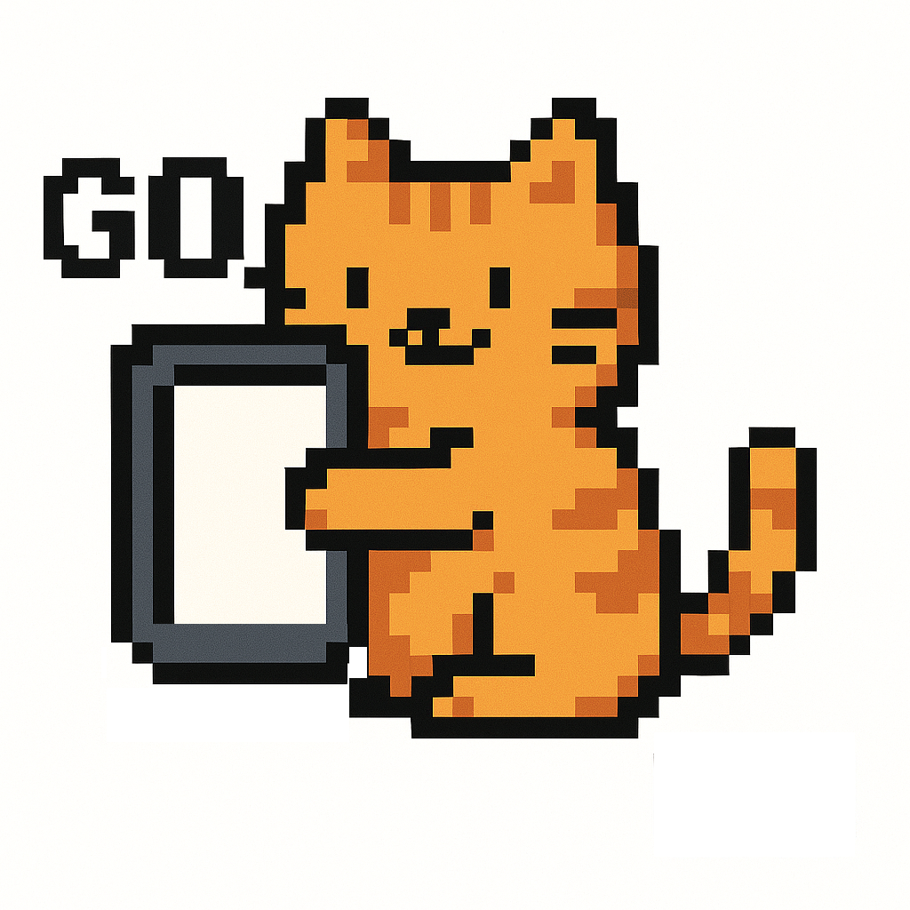

  

  # 🧙‍♂️ Go Daijishou

  **루팅된 LG Wing의 세컨드 스크린 홈을 원하는 런처로 바꿔주는 Xposed 모듈**

  
  

  **[📦 최신 APK 다운로드](https://github.com/jshsakura/GoDaijishou/releases/latest)**

  
  
  

---

## 개요

LG Wing의 두 번째 런처인 `com.lge.secondlauncher`의 홈 화면 동작을 가로채, 세컨드 스크린을 **원하는 런처로 대체**합니다. 초기 버전은 다이지쇼(Daijishou)만 지원했지만, 이제는 설정 앱에서 여러 런처 중 골라 쓸 수 있습니다.

## 지원 런처

| 런처 | 패키지 |
| --- | --- |
| Daijishou (다이지쇼) | `com.magneticchen.daijishou` |
| ES-DE | `org.es_de.frontend` |
| Pegasus (페가수스) | `org.pegasus_frontend.android` |
| LG 기본 런처 | *(리다이렉트하지 않음)* |

선택한 런처가 설치돼 있지 않으면 리다이렉트하지 않고 안내 메시지를 표시합니다.

## 주요 특징

- 🎯 **런처 선택 UI** — 설정 앱에서 세컨드 스크린 홈으로 쓸 런처를 골라 저장. 변경 사항은 `ContentObserver`로 **즉시 반영**됩니다.
- 🪶 **초경량 후킹** — `onResume` 한 지점만 후킹하고, 대부분의 콜백은 디스플레이 체크 후 즉시 반환. 설정값은 캐시되어 **생명주기마다 크로스-프로세스 쿼리가 없음** → 상시 부하 ≈ 0.
- 🔥 **발열 방지** — 런처끼리 튕겨내는 오실레이션 루프를 감지하면 쿨다운을 자동으로 늘리는 백오프로 CPU 폭주·발열을 차단합니다.
- 🖥️ **검정화면 수정** *(v1.3)* — 게임(RetroArch 등) 실행 중 세컨드 스크린으로 복귀할 때 생기던 검정화면(소리만 나던) 문제를 해결. 세컨드 홈을 폴백용으로 유지하고, 복귀 시 레트로아크의 렌더링 서피스를 강제 재생성합니다. LSPosed 스코프에 RetroArch를 체크해야 동작합니다.
- 🌙 **하단 화면 전용 모드** *(v1.5)* — 스위블이 열려 있는 동안 상단 패널 전원을 끄고, 상단에 뜨던 대화상자는 하단 화면으로 보냅니다. 렌더링·발열이 줄어듭니다.
- 📵 **상단 화면 없음** *(v1.5)* — 하단 화면만 쓰는 윙용. 상단 패널을 늘 끄고 대화상자·알림·볼륨 바를 하단에 띄웁니다.
- 🔊 **볼륨 바** *(v1.5)* — 지금 쓰는 화면 오른쪽 가장자리에 얇은 세로 볼륨 바. 시스템이 직접 그려서 추가 권한이 없고 입력을 가로채지 않습니다.
- ⏻ **하단 전원 메뉴** *(v1.5)* — 스위블이 열려 있을 때 전원키를 길게 누르면 하단 화면에 전원 끄기·다시 시작·스크린샷·리커버리 메뉴가 뜹니다.
- 🔄 **회전 강제** *(v1.5, 구 [GoRotation90](https://github.com/jshsakura/GoRotation90) 통합)* — 자동회전 토글을 회전 스위치로 사용합니다. 자동회전 OFF → 가로(90°) 고정, ON → 세로 고정. 설정 앱에서 켜고, LSPosed 스코프에 **시스템 프레임워크(android)** 를 체크해야 동작합니다. 꺼져 있으면 훅은 즉시 반환합니다.
- 🔐 **루트·민감 권한 없음** *(v1.5)* — 앱은 루트 명령도, "다른 앱 위에 표시" 같은 권한도 쓰지 않습니다. 전원·스크린샷·화면 제어는 시스템 프레임워크 훅이 처리하고, 그 요청은 같은 서명의 앱만 보낼 수 있습니다. 모든 스위치는 첫 설정 후 재부팅 없이 바로 적용됩니다.

> ⚠️ **알려진 한계**: RetroArch가 실행 중인 상태에서 프론트엔드로 다른 게임을 고르면 이전 게임이 다시 뜨거나 화면이 깨질 수 있습니다. RetroArch 1.16.0 이후 프론트엔드의 kill-before-launch가 깨진 [알려진 문제](https://github.com/TapiocaFox/Daijishou/issues/703)로, 모듈이 아닌 프론트엔드/RetroArch에서 해결돼야 하는 부분입니다. 게임을 바꿀 때는 RetroArch를 종료(또는 강제 종료)한 뒤 선택하세요.

## 요구 사항

- **루팅된 LG Wing**
- **LSPosed** (또는 호환 Xposed 프레임워크)
- 대체할 런처 앱(Daijishou / ES-DE / Pegasus) 중 하나 설치

## 설치 및 사용

1. 최신 [릴리즈](https://github.com/jshsakura/GoDaijishou/releases)에서 APK 설치
2. **LSPosed**에서 모듈 활성화 → 적용 대상(Scope)에 `com.lge.secondlauncher` 선택
   - RetroArch 검정화면·게임 전환 수정을 쓰려면 `com.retroarch`(또는 `.aarch64`/`.ra32`)도 함께 체크
   - 회전 강제·하단 화면 전용·볼륨 바·전원 메뉴를 쓰려면 `시스템 프레임워크(android)`도 체크 *(기존 GoRotation90은 비활성화·삭제)*
3. **재부팅** *(Xposed 모듈은 대상 프로세스 시작 시 로드되므로 필수)*
4. `GoDaijishou 설정` 앱을 열어 원하는 런처 선택
5. 세컨드 스크린 홈이 선택한 런처로 바뀝니다

## 동작 방식

`com.lge.secondlauncher` 프로세스에 로드되어 `Activity.onResume`를 후킹합니다. 세컨드 스크린(디스플레이 4)에서 홈이 표시될 때, `ContentProvider`로 공유되는 설정값의 대상 런처를 그 디스플레이에 실행합니다. 시스템 파일을 수정하지 않고 **Xposed 후킹만으로** 동작합니다.

---

## English

**Go Daijishou** is an Xposed module for rooted LG Wing smartphones. It intercepts the home behavior of the second launcher (`com.lge.secondlauncher`) and redirects the second screen to a launcher of your choice — **Daijishou, ES-DE, Pegasus, or the stock LG launcher**.

**Highlights**
- Pick your second-screen launcher from the settings app (applied instantly via `ContentObserver`)
- Ultra-light hooking: lifecycle-event hooks only, cached settings, near-zero idle overhead — no logging
- Heat protection via exponential backoff against redirect oscillation
- *(v1.3)* Fixed the black-screen-on-return issue when coming back to a running game on the second screen: keeps the fallback home and forces surface recreation on resume. Enable by adding RetroArch to the LSPosed scope.
- *(v1.5)* Bottom-screen-only mode: powers the top panel off while the swivel is open and opens anything bound for it on the bottom screen.
- *(v1.5)* No-top-screen mode for Wings with only the bottom screen; volume bar and power menu on the bottom screen.
- *(v1.5)* No root commands and no sensitive permissions in the app: privileged work is done by the System Framework hook.
- *(v1.5)* Rotation forcing (merged from GoRotation90): the auto-rotate toggle acts as a rotation switch — OFF locks landscape (90°), ON locks portrait. Enable it in the settings app and add *System Framework* to the LSPosed scope.
- Known limitation: launching another game over a *running* RetroArch may bring back the previous game — a [known RetroArch ≥1.17 issue](https://github.com/TapiocaFox/Daijishou/issues/703) that belongs to the frontend/RetroArch side; quit RetroArch before switching games.

**Requirements**: rooted LG Wing, LSPosed (or a compatible Xposed framework), and the target launcher installed.

**Install**: install the APK → enable the module in LSPosed with the scope `com.lge.secondlauncher` (optionally add `com.retroarch` / `.aarch64` / `.ra32` for the RetroArch fixes, and `android` (System Framework) for rotation, bottom-screen modes, volume bar and power menu) → reboot → open *GoDaijishou Settings* and pick a launcher.

It uses the Xposed framework to achieve system-level behavior changes without modifying the original system files.
