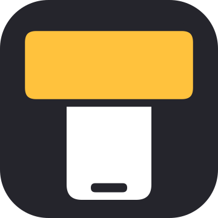
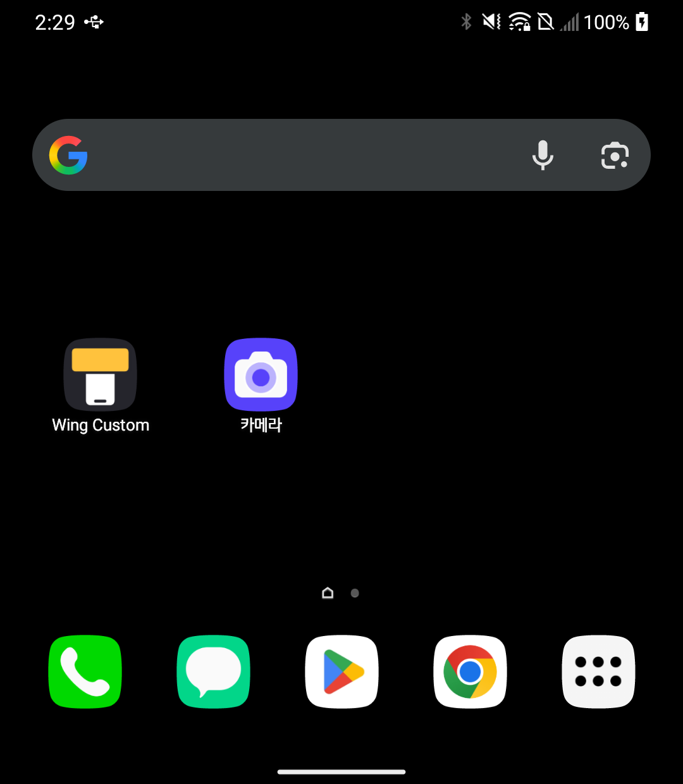
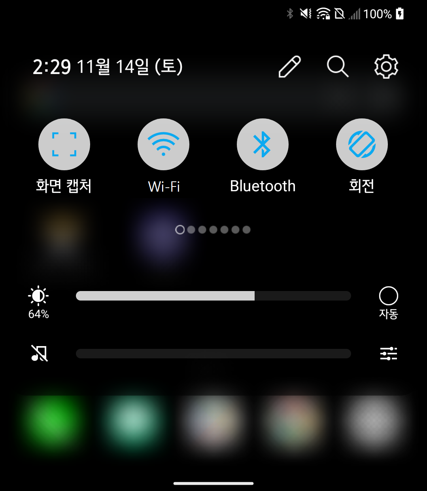
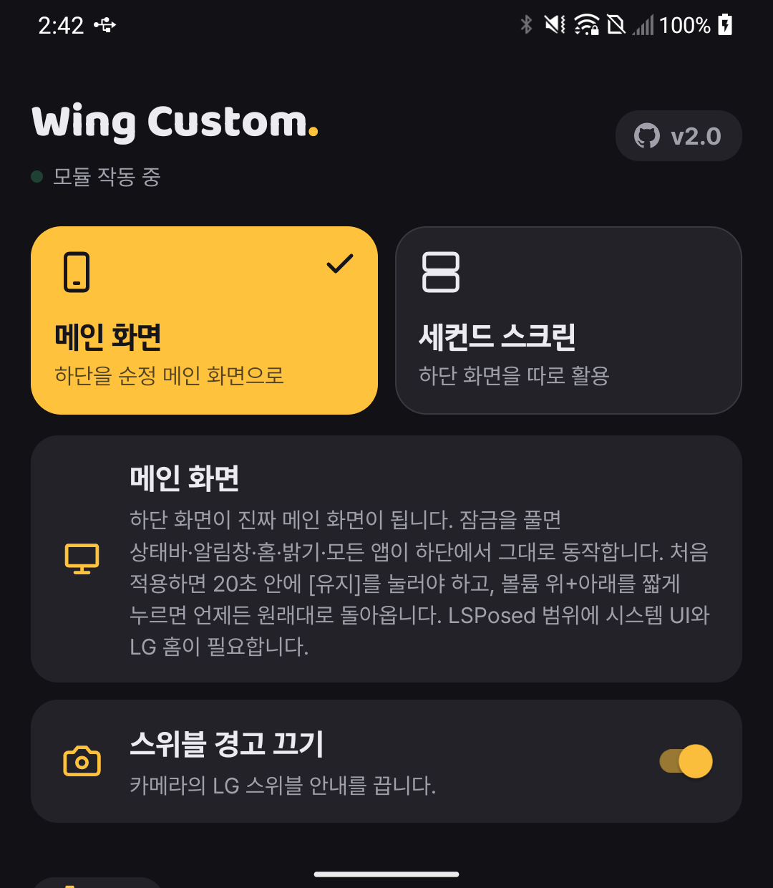
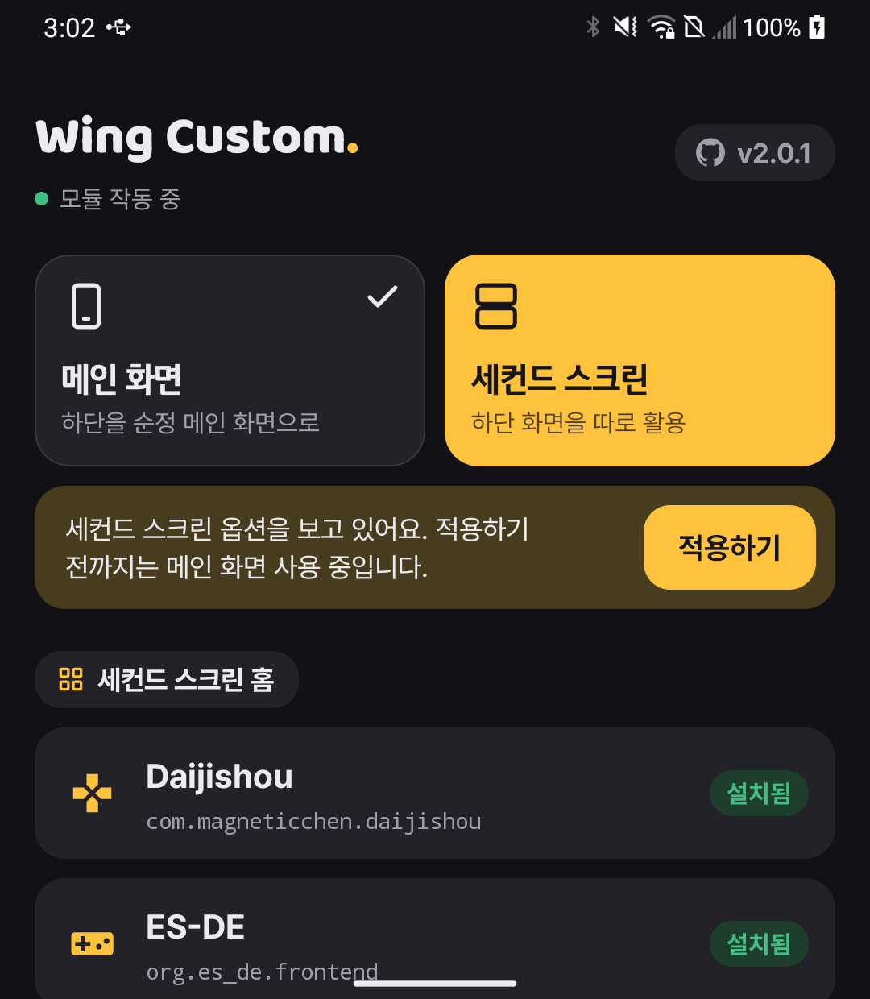
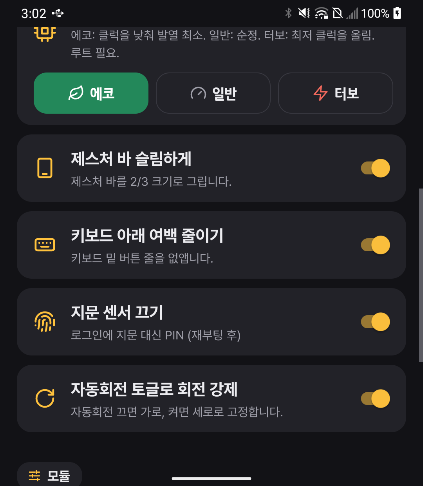
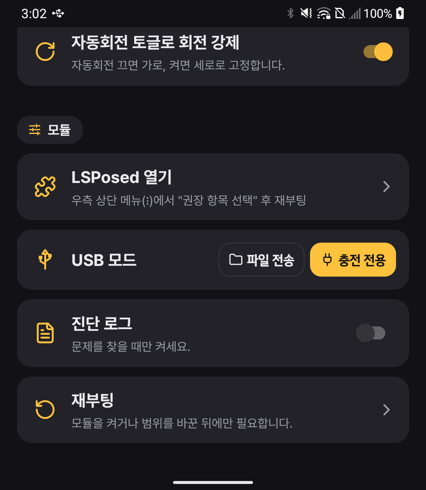

  

  # Wing Custom

  **루팅된 LG Wing을 하단 화면 하나로도 온전한 폰처럼 쓰게 해 주는 Xposed 모듈**

  
  

  **[📦 최신 APK 다운로드](https://github.com/jshsakura/GoDaijishou/releases/latest)**

  
  
  
   
  
  
  

  메인 스크린 모드의 홈 · 빠른 설정 · 앱 설정 / 세컨드 스크린 옵션 · 공통 옵션 · 모듈 설정

> 예전 이름은 **Go Daijishou**입니다. 패키지명(`kr.opencourse.godaijishou`)은 그대로라서, 기존 앱 위에 덮어 설치하면 설정과 LSPosed 범위가 그대로 유지됩니다.

---

## 두 가지 모드

앱 첫 화면의 탭에서 고르고 **적용**을 누릅니다.

### 📱 메인 스크린 모드 (새 기능)

하단 화면을 **진짜 메인 디스플레이(display 0)** 로 연결합니다. 화면을 복사(미러)하는 방식이 아니라, 안드로이드 디스플레이 매니저가 하단 패널을 메인 스크린으로 쓰도록 바꿉니다. 그래서 상단 패널이 고장 났거나 떼어 낸 Wing도 하단만으로 보통 폰처럼 쓸 수 있습니다.

> 💡 **메인 스크린 모드는 어디까지나 보조 기능입니다.** 평소 쓰는 **홈 런처(Nova·Niagara 등 원하는 런처)를 기본 홈 앱으로 설정해서 쓰는 것을 권장합니다.** LG 홈 관련 처리는 LG 홈을 그대로 쓸 때를 위한 보완일 뿐입니다.

- 하단 패널 고유의 해상도·vsync·터치로 상태바, 알림창, 빠른 설정, 홈, 앱이 그대로 돌아갑니다.
- **LG 홈은 항상 일반 홈**으로 뜹니다(스위블 홈 대신).
- **LG 카메라**가 스위블 레이아웃 대신 일반 폰 카메라로 실행됩니다(스위블 레이아웃은 이 화면 크기에서 크래시).
- **빠른 설정**은 짧은 화면에 맞게 1줄로 정리되고, 나머지 타일은 옆으로 넘깁니다.
- **밝기 슬라이더**가 하단 패널 밝기를 바로 조절합니다(드래그하는 동안에도).
- **밝기 하나로**: 메인 밝기와 LG 세컨드 스크린 밝기가 서로 같은 값을 따라가서, 두 값이 번갈아 적용되며 밝기가 튀지 않습니다.
- **회전 강제**(자동회전 끔 = 가로, 켬 = 세로)가 메인 스크린에도 적용됩니다.
- 처음 [유지]하면 LG 홈 그리드를 **4×4로 한 번** 맞춥니다(그 뒤에 바꾼 그리드는 그대로 둡니다).

#### 키로 전환

| 키 | 동작 |
| --- | --- |
| **볼륨 위 + 아래 동시에 짧게** | 메인 스크린 ↔ 세컨드 스크린 전환. 앱의 모드 탭도 같이 바뀝니다. 화면이 꺼져 있거나 잠금 중이면 모드만 바꿔 두고 잠금을 풀 때 적용합니다(진동 한 번 = 세컨드 스크린, 두 번 = 메인 스크린). |
| **볼륨 아래만 10초 길게** | **비상탈출.** 무조건 세컨드 스크린으로 돌아가고, 다시 켤 때까지 재부팅해도 그대로입니다. |

> 볼륨 아래 + 전원 10초는 LG 강제 재부팅이니 비상탈출은 볼륨 아래만 누르세요. 볼륨 위 + 아래를 **3초 이상** 누르고 있으면 안드로이드 접근성 단축키(TalkBack 등)가 동작할 수 있으니 전환할 때는 짧게 누르세요.

#### 절대 갇히지 않게

화면이 꺼지거나 터치가 안 되는 상태에 빠지지 않도록, 여러 겹의 안전장치가 있습니다.

| 상황 | 동작 |
| --- | --- |
| 처음 켤 때 | 바뀐 화면에 **"이 화면을 메인 스크린으로 쓸까요? [유지]"** 카드가 뜹니다. **20초 안에 유지를 누르지 않으면 자동으로 원래대로** 돌아갑니다. 한 번 유지하면 그 뒤로는 묻지 않고 바로 전환됩니다. |
| 언제든 | **볼륨 아래만 10초 길게**(비상탈출) 또는 **볼륨 위 + 아래**(전환)로 화면도 터치도 없이 세컨드 스크린으로 돌아옵니다. 시스템이 앱을 기다리지 않고 즉시 되돌립니다. |
| 잠금 화면 | 화면 배치를 그대로 고정합니다. 부팅 직후부터 **일반 폰 잠금 화면이 아래 화면에 그대로** 뜨고, 터치·노크온(두 번 두드려 켜기)으로 바로 해제합니다. 화면을 끄면 아래 패널 전원도 실제로 꺼집니다. |
| 복구 확인 | 원래대로 돌아갈 때 하단 터치가 살아났는지 확인하고, 아니면 한 번 바로잡은 뒤 그래도 안 되면 재부팅합니다(재부팅하면 항상 원래 배치). |
| 필요한 훅이 없을 때 | 시스템 프레임워크·시스템 UI·LG 홈이 이번 부팅에 로드되지 않았으면 **켤 수 없고**, 앱이 무엇이 빠졌는지 ✓/✗로 보여 줍니다. 켜 둔 뒤에 빠지면 세컨드 스크린 모드로 동작합니다. |

### 🖥️ 세컨드 스크린 모드 (기존 기능)

스위블을 연 상태의 하단 화면을 자기만의 화면으로 씁니다.

- 🎯 **세컨드 홈 런처 교체** — Daijishou / ES-DE / Pegasus / LG 기본 중 선택, 즉시 반영
- 🌙 **상단 화면 끄기** — 스위블을 연 동안 상단 패널 전원을 끄고, 상단으로 가던 대화상자·알림은 하단으로
- 🔋 **배터리 바** — 와이파이·모바일 데이터·배터리·알림 개수, 모양·위치·전체화면 숨김 선택
- 🔊 **볼륨 바**
- 🖥️ **RetroArch 검정화면 수정** — 게임 복귀 시 렌더링 서피스 재생성
- 📲 **새 앱 하단 화면 자동 허용**

### 두 모드 공통

- 👆 **홈 제스처 보완** — 홈 앱이 무엇이든(Nova·Daijishou·ES-DE·Pegasus 등) 하단 스와이프는 LG 제스처 엔진(quickstep)이 처리하고, 모듈은 그 엔진이 꺼져 있을 때(런처 재시작 중)만 홈·최근 앱을 대신 실행. 메인 화면 모드에서는 화면이 바뀔 때 최근 앱 레이아웃을 새 화면에 맞추고, 잠금 중 LG AOD가 세컨드 화면을 터치 안 되는 상태로 켜는 것을 막음
- 🔄 **회전 강제** — 자동회전 토글을 회전 스위치로(끔 = 가로, 켬 = 세로)
- ☝️ **지문 센서 없음 처리** — 상단 화면 아래 지문 센서를 쓸 수 없을 때
- 📷 **스위블 경고 끄기** — 세컨드 스크린에서 카메라를 켤 때 뜨는 LG 스위블 안내
- 🪶 **슬림 제스처 바**, ⌨️ **키보드 아래 여백 줄이기**
- ⚡ **성능 프로필** — 에코 / 일반(완전 순정) / 터보
- 🔌 **USB 모드** — 파일 전송 / 충전 전용
- ⏻ **전원 메뉴** — 전원 키를 길게 누르면 어느 모드든 하단에 뜹니다(따로 켤 필요 없음)

## 요구 사항

- **루팅된 LG Wing** (LM-F100N, Android 13 LG 펌웨어에서 확인)
- **LSPosed** (또는 호환 Xposed 프레임워크)

## LSPosed 범위

앱의 **LSPosed 열기 → 우측 상단 ⋮ → 권장 항목 선택**으로 한 번에 체크할 수 있습니다.

| 범위 | 용도 |
| --- | --- |
| 시스템 프레임워크 (`android`) | 메인 스크린 모드, 회전, 상단 끄기, 볼륨 바, 전원 메뉴, 지문, 탈출 키 **(필수)** |
| 시스템 UI (`com.android.systemui`) | 빠른 설정 1줄, 제스처 바, 키보드 여백 **(메인 스크린 모드 필수)** |
| LG 홈 (`com.lge.launcher3`) | 메인 스크린에서 항상 일반 홈 **(메인 스크린 모드 필수)** |
| LG 카메라 (`com.lge.camera`) | 메인 스크린 모드에서 카메라 실행 |
| 세컨드 런처 (`com.lge.secondlauncher`) | 세컨드 홈 런처 교체 |
| LG 키보드 (`com.lge.ime`) | 키보드 아래 여백 줄이기 |
| LG 팝업 카메라 (`com.lge.popupcamera`) | 스위블 경고 끄기 |
| RetroArch (`com.retroarch` 등) | 검정화면 수정 |

## 설치

1. [릴리즈](https://github.com/jshsakura/GoDaijishou/releases)에서 APK 설치 (기존 Go Daijishou 위에 덮어 설치 가능)
2. LSPosed에서 모듈을 켜고 범위를 체크 (위 표)
3. **재부팅**
4. **Wing Custom** 앱에서 모드를 고르고 **적용**
5. 메인 스크린 모드라면 바뀐 화면의 **[유지]** 를 20초 안에 누르기

### 앱 안 업데이트와 Play 프로텍트

앱 상단의 **업데이트 vX.Y.Z** 를 누르면 GitHub 릴리즈의 APK를 받아 확인(SHA-256, 패키지, 서명 키)한 뒤 직접 설치합니다. 이 기능 때문에 Google Play 프로텍트가 **"앱 검사 권장됨"** 창을 띄울 수 있습니다. 스토어 밖에서 받았고 스스로 업데이트하는 앱이라 처음 보는 앱으로 판단해서입니다.

- **앱 검사**를 누르면 검사 후 설치가 이어집니다. **앱 설치 안함**을 누르면 지금 버전이 그대로 유지됩니다.
- 각 릴리즈 노트 아래에 APK의 SHA-256과 VirusTotal 검사 결과 링크가 있어, 받은 파일이 그 릴리즈와 같은지, 악성으로 잡히는지 직접 확인할 수 있습니다.
- 처음 한 번은 Android 확인 창이 뜰 수 있고, 그 뒤로는 앱이 설치 주체가 되어 조용히 업데이트됩니다. 재부팅은 하지 않으며, 바뀐 기능은 다음 재부팅 때 적용됩니다.

## 기기 테스트 (개발용)

폰을 연결하고 잠금을 푼 뒤 `tools/device-test.sh [왕복 횟수]`를 실행하면, 볼륨 위 + 아래로 메인 ↔ 세컨드를 오가며 매번 화면 배치·홈 제스처 감시·홈·뒤로·최근 앱·전원 메뉴·밀도·감시 장치 누수를 확인합니다.

## 알려진 한계

- 하단 패널은 1080×1240으로 정사각형에 가까워, 세로로 긴 화면을 가정한 앱은 아래쪽이 좁게 보일 수 있습니다. LG 홈은 **설정 → 디스플레이 → 홈 화면 → 그리드**에서 4×4 등으로 맞추면 보기 좋습니다.
- RetroArch가 실행 중일 때 프론트엔드에서 다른 게임을 고르면 이전 게임이 다시 뜰 수 있습니다([RetroArch 쪽 알려진 문제](https://github.com/TapiocaFox/Daijishou/issues/703)). 게임을 바꿀 때는 RetroArch를 먼저 종료하세요.

---

Wing Custom (formerly Go Daijishou): an LSPosed module that makes the bottom panel of a rooted LG Wing its real main display, plus second-screen tweaks. Korean UI.
